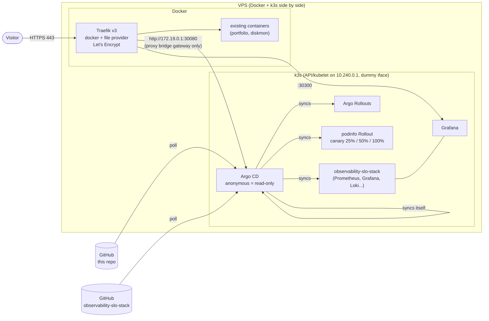

# homelab-gitops

[](https://github.com/bhavishyajain545/homelab-gitops/actions/workflows/lint.yaml)

A single-node **k3s** cluster on a VPS, run entirely through **GitOps with Argo CD**
(app-of-apps), with **Argo Rollouts** doing progressive delivery. The cluster sits
*behind* an already-running Docker Traefik and never listens on the public
interface itself.

**Live, read-only:** https://argocd.futurnex.io (no login needed - browse the
apps, resource trees, sync history and the canary Rollout).
Companion project deployed by this repo:
[observability-slo-stack](https://github.com/bhavishyajain545/observability-slo-stack)
-> https://grafana.futurnex.io

## Architecture



### App-of-apps

```
bootstrap/root-app.yaml      <- the only manifest applied by hand
└── apps/                    <- every file is an Argo CD Application
    ├── argocd.yaml          (wave -10) Argo CD manages its own Helm release
    ├── argo-rollouts.yaml   (wave 0)   controller + CRDs
    ├── rollouts-demo.yaml   (wave 1)   workloads/rollouts-demo (kustomize)
    └── observability.yaml   (wave 2)   -> observability-slo-stack/apps (its own app-of-apps)
```

All Applications use automated sync with `prune` + `selfHeal`, so the cluster is
whatever `main` says (except Argo CD itself, which never auto-prunes).

## Repository layout

| Path | What |
|------|------|
| `bootstrap/` | Idempotent scripts: `00-host.sh` -> `10-k3s.sh` -> `20-argocd.sh` -> `30-traefik.sh` (`bootstrap.sh` runs all). Versions pinned in `common.sh`. |
| `host/` | k3s config template, private interface + port guard (systemd units), Traefik route template and DNS gate. |
| `apps/` | Argo CD Applications (app-of-apps children). |
| `platform/` | Helm values for Argo CD and Argo Rollouts. |
| `workloads/rollouts-demo/` | podinfo `Rollout` with canary steps + stable/canary Services. |
| `.github/workflows/lint.yaml` | yamllint, shellcheck, kubeconform (raw manifests and rendered charts). |

## Versions

| Component | Version |
|-----------|---------|
| k3s | v1.36.5+k3s1 (bundled Traefik and ServiceLB disabled) |
| Helm | v4.3.1 |
| Argo CD | chart `argo-cd` 10.11.1 (app v3.5.6) |
| Argo Rollouts | chart `argo-rollouts` 2.43.8 (app v1.10.1) |
| Demo app | `ghcr.io/stefanprodan/podinfo` 6.15.0 |

## Reproduce

Requirements: a Linux host with Docker + Compose, an existing Traefik container
on an external Docker network called `proxy` with a Let's Encrypt resolver named
`letsencrypt`, and DNS A records for the hostnames you want to expose.

```bash
git clone https://github.com/bhavishyajain545/homelab-gitops.git /opt/src/homelab-gitops
cd /opt/src/homelab-gitops
sudo ./bootstrap/bootstrap.sh          # safe to re-run
```

What it does:

1. **00-host** - creates a dummy interface `k3s0` (10.240.0.1) and the
   `homelab-guard` port guard (see Security), both as systemd units.
2. **10-k3s** - writes `/etc/rancher/k3s/config.yaml` from `host/k3s-config.yaml`,
   installs the pinned k3s, kubectl (k3s symlink) and Helm.
3. **20-argocd** - creates `argocd-secret` with a random admin password (saved to
   `/root/homelab-secrets/argocd-admin.txt`, mode 600, never in Git), installs the
   pinned chart once with Helm, applies `bootstrap/root-app.yaml`. From then on
   Argo CD manages everything, including its own upgrades.
4. **30-traefik** - adds a file provider (`./dynamic` directory) to the existing
   Traefik compose file (backup kept), recreates only the Traefik container, and
   installs `homelab-dns-gate.timer`.

To fork it: change the `repoURL`s in `apps/` and `bootstrap/root-app.yaml`,
the hostnames in `host/traefik/dns-gate.sh` and `platform/argocd/values.yaml`.

### Try the canary

Change the image tag in `workloads/rollouts-demo/rollout.yaml`, push, and watch the
`rollouts-demo` app in Argo CD: the Rollout shifts 25% of replicas, pauses 2 min,
50%, pauses 2 min, then promotes. (`kubectl argo rollouts get rollout podinfo -n rollouts-demo -w`
shows the same from a shell.)

## Security notes

The VPS has **no host firewall** and other production containers run on it, so
the design goal was: *nothing new is reachable from the internet except through
the existing Traefik on 443.*

| Surface | Exposure | How |
|---------|----------|-----|
| Kubernetes API 6443, kubelet 10250 | private only | `bind-address`, `node-ip`, `advertise-address` and kubelet `address` are 10.240.0.1 on a dummy interface; controller-manager/scheduler/kube-proxy health/metrics bind 127.0.0.1. |
| NodePorts (30080 Argo CD, 30300 Grafana) | Docker `proxy` bridge only | kube-proxy `--nodeport-addresses=172.19.0.1/32` - the Traefik container can reach them, the internet cannot. |
| Flannel | none | `host-gw` backend on single node: no VXLAN (udp/8472) listener. |
| node-exporter (hostNetwork) | private only | listens on the host IP 10.240.0.1, not 0.0.0.0. |
| Port 80/443 | unchanged | owned by the Docker Traefik; k3s Traefik + ServiceLB disabled. |
| Argo CD UI | public, read-only | `users.anonymous.enabled` + `policy.default: role:public` - get on apps/projects/clusters/repos only; no logs, exec, sync or actions. `exec.enabled: false`. Dex, notifications, ApplicationSet controller disabled. |
| Secrets | server only | admin passwords live in `/root/homelab-secrets/` (600) and in-cluster Secrets created by scripts; the Argo CD chart is told not to manage `argocd-secret`. Git contains no credentials. |

**Belt and braces - `homelab-guard`.** `host/homelab-guard.sh` adds one chain in the
`mangle` table, jumped to from `PREROUTING` for **new** connections arriving on the
public NIC, which drops tcp 6443, 6444, 2379-2380, 9100, 10248-10260, 30000-32767
and udp 8472, 51820-51821, 30000-32767 (IPv4 and IPv6). It runs before Docker's and
kube-proxy's NAT rules, never flushes their chains, and is idempotent. It matches
only `NEW` conntrack state because flannel masquerades pod egress with
`--random-fully`, so *replies* to outbound connections can legitimately land on
ports inside the NodePort range.

Verified from outside: `curl -sk -m 5 https://<ip>:6443`, `:10250`, `http://<ip>:30080`
and `:30300` all time out.

**TLS and Let's Encrypt rate limits.** A Traefik router with `certResolver` makes
Traefik request a certificate immediately; if DNS isn't there yet the HTTP-01
challenge fails and repeated failures hit Let's Encrypt's failed-validation limit.
`host/traefik/dns-gate.sh` (systemd timer, every 10 min) only writes a route file
once **both** 1.1.1.1 and 8.8.8.8 return this server's IP for the hostname.

**Known trade-offs.** Anonymous Argo CD users can see manifests of synced
resources (Secret values are redacted by Argo CD). Grafana's anonymous access is
discussed in the observability repo.

## License

[MIT](LICENSE)
